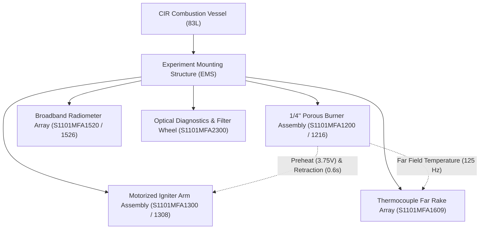
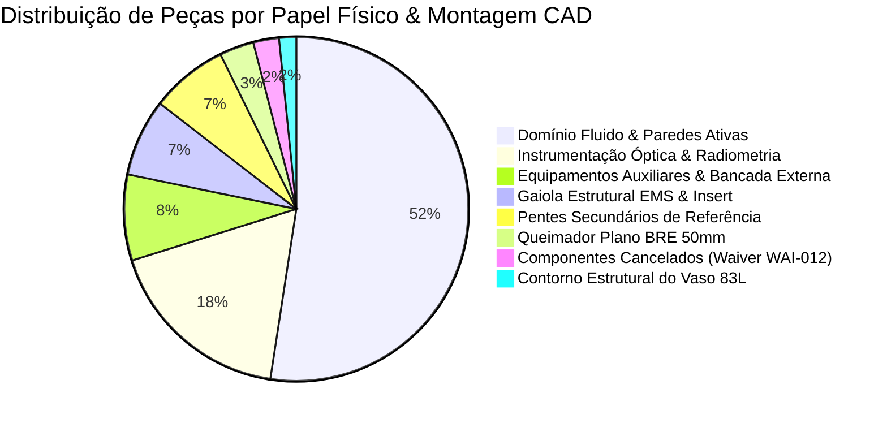
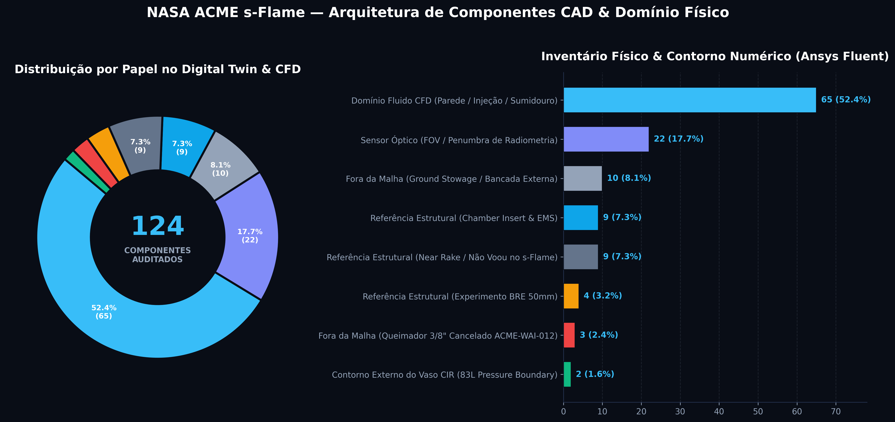
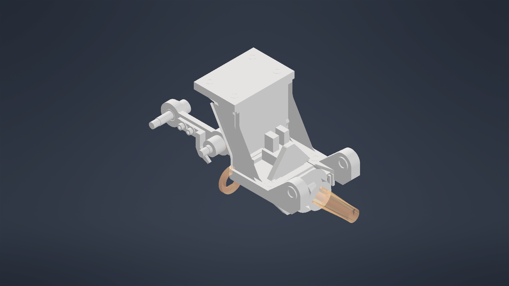
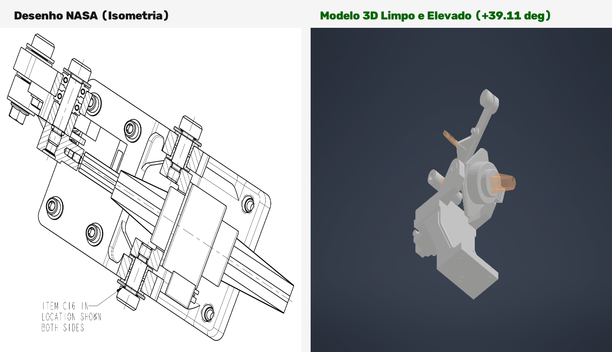

# NASA ACME Microgravity Flight Hardware
## 3D CAD Reverse Engineering, Parametric Synthesis & Hybrid Aerospace Modeling

---

### Abstract

This repository provides the complete computer-aided engineering (CAD) reverse-engineering dataset, parametric reconstruction models, and manufacturing drawing archives for the **NASA ACME (Advanced Combustion via Microgravity Experiments)** flight hardware, conducted aboard the International Space Station (ISS) within the Combustion Integrated Rack (CIR).

The project synthesizes physical flight blueprints into production-ready 3D parametric solids across a **dual-track hybrid modeling methodology**:
1. **Automated Parametric Scripting (Python + Autodesk Inventor API):** Procedural generation of axisymmetric cylindrical envelopes, concentric through-hole arrays, standardized fastener assemblies, aerospace material properties, and batch export to STEP AP214 (`.stp`).
2. **Expert Manual Reverse Engineering (Emerson B. J.):** Dedicated manual 3D modeling and geometric resolution for high-complexity flight components characterized by tight aerospace GD&T tolerances, compound datum references (Datums A, B, and C), delicate thin-wall retention features ($0.016"$), and multi-feature kinematic interfaces that exceeded automated procedural algorithms.

---

### 1. Flight Hardware Architecture & Mission Context

The NASA ACME hardware represents a modular microgravity combustion insert designed to operate within the 83-liter CIR pressure vessel in microgravity ($10^{-6}\;g$). By eliminating buoyant natural convection, ACME isolates pure diffusion kinetics, soot formation, and radiative extinction.



The flight system comprises eight interconnected aerospace assemblies:
* **Porous Spherical Burner:** Sintered bronze matrix ($\varnothing 6.25\text{ mm} = 1/4"$) supplied by fine cap tubes ($OD=1.80\text{ mm}$, deviation ACME-DEV-031).
* **Articulated Igniter Subsystem:** Rotary motorized arm delivering a Kanthal A-1 loop filament ($2.25 \to 3.75\text{ V}$) with a 0.60 s retraction delay (ACME-DEV-050).
* **Thermal Rake Arrays:** Far Array rake supporting 4 thermocouple stations ($45, 60, 100, 100\text{ mm}$) and dual 200 mm far-field boundary sensors.
* **Radiometer & Optical Diagnostics:** Dexter thermopile wide-view and offset radiometers ($60^\circ$ offset) with precision lensless apertures.
* **Containment & Structural Cage:** 83-liter CIR pressure vessel enclosing the Experiment Mounting Structure (EMS).

---

### 2. Complete Flight Hardware Inventory & Breakdown (124 Components)

A rigorous 124-component engineering audit was conducted, cross-referencing all NASA Manufacturing Drawings (MFD), Assembly Prints (MFA), and engineering waiver records (`ACME_engineering_20210328.pdf`):



<p align="center">
  
</p>

#### Interactive Catalog & Engineering Archives:
* **Interactive Web Dashboard:** [`pecas_faltantes.html`](pecas_faltantes.html) — Dynamic browser checklist with multi-tier search, real-time counters, and 1-click links to NASA blueprints and 3D STEP models.
* **Master Engineering Spreadsheet:** [`pecas_faltantes.xlsx`](pecas_faltantes.xlsx) — Native Excel matrix with 202 hyperlinked drawing files, conditional formatting, and frozen navigation panes.
* **Portable Flat Table:** [`pecas_faltantes.csv`](pecas_faltantes.csv) — Programmatic CSV export with `=HYPERLINK` formulas for automated build pipelines.

---

### 3. Hybrid Modeling Methodology: AI Automation vs. Expert Manual Synthesis

Aerospace hardware exhibits extreme geometric diversity ranging from elementary rotational pins to asymmetric compound sleeves with tight true-position tolerances relative to compound Datums. A strict division of labor was implemented:

```
┌────────────────────────────────────────────────────────────────────────┐
│                   NASA ACME HYBRID CAD PIPELINE                        │
├───────────────────────────────────┬────────────────────────────────────┤
│   ALGORITHMIC AUTOMATION (IA)     │    EXPERT REVERSE ENG. (HUMAN)     │
│   Python COM + Autodesk Inventor  │    Emerson B. J. (Lead CAD Eng.)   │
├───────────────────────────────────┼────────────────────────────────────┤
│ • Axisymmetric support tubes      │ • Intricate compound Datums (A/B/C)│
│ • Cylindrical burner sleeves      │ • Thin-wall retention tabs (0.016")│
│ • Concentric through-hole arrays  │ • Asymmetric shoulder sleeves      │
│ • Commercial fastener integration │ • Complex multi-link kinematics    │
│ • Automated material assignment   │ • Critical ceramic insulators      │
│ • Batch AP214 STEP conversion     │ • Tight True Position GD&T checks  │
└───────────────────────────────────┴────────────────────────────────────┘
```

#### 3.1 Algorithmic Automation (Python + Autodesk Inventor API):
* Parameterized routines (`scripts/inventor_cad_automation.py`) generate rotational baseline envelopes, concentric bores, and standard chamfers.
* Automatic assignment of physical aerospace materials: Inconel 625, 316L Stainless Steel, Copper-Beryllium, and Alumina ($Al_2O_3$).
* Automated multi-format export to STEP AP214 (`.stp`) and Autodesk Inventor (`.ipt`).

#### 3.2 Expert Manual Modeling & GD&T Resolution (Emerson B. J.):
* **S1101MFD1237 (BRE Flow Screen Sleeve):** High-complexity boundary sleeve with asymmetric shoulder geometry ($1.962"$ outer diameter, $0.016"$ wall thickness), dual alignment slots, and integrated tab features.
* **S1101MFD1238 (BRE 50 mm Flow Screen):** High-mesh planar diffusion screen featuring a precision central bore ($\varnothing 0.320"$) and secondary probe passage ($\varnothing 0.161"$) maintained at true position tolerances.
* **S1101MFD1202 (Burner Insulator Pair):** Dual ultra-thin fluorocarbon/ceramic insulating sheets ($0.010"$ each, $0.020" = 0.508\text{ mm}$ total) with precision oblong O-ring clearance slots.
* **S1101MFA1300 Kinematic Linkage:** Alignment of the articulated 4-bar mechanism ensuring exact deployed ($+39.11^\circ$) and retracted ($-26.38^\circ$) stroke angles without mechanical binding.

<p align="center">
  
</p>

---

### 4. Kinematic & Assembly Verification

#### 4.1 Igniter Actuator Kinematics:
The igniter mechanism (`S1101MFA1300`) delivers the Kanthal filament from standby position to the porous sphere surface:
* **Deployed Angle:** $+39.11^\circ$ (Apex clearance $= 1.25\text{ mm}$ above porous sphere).
* **Retracted Angle:** $-26.38^\circ$ (Stowage standby).
* **Total Stroke:** $65.49^\circ$ across an $85.25\text{ mm}$ radial arm.
* **Verification Script:** [`scripts/verify_kinematics.py`](scripts/verify_kinematics.py) confirms zero spatial interference with the insert structural framework.

<p align="center">
  
</p>

#### 4.2 Burner Base & Sealing Stack:
The base assembly (`S1101MFA1200`) isolates the conductive burner stem from the EMS cold plate:
* Dual fluorocarbon Viton O-rings (`AS3209-013`) rated to $3.0\text{ atm}$.
* Four modified socket head cap screws (`S1101MFP1025`, $.190\text{-}32\text{ UNRF-3A} \times .750"$).
* Stepped ceramic bushings (`S1101MFD1204` and `1205`) preventing parasitic conductive bridging.

---

### 5. Repository Structure

```
nasa-acme-cad-engineering/
├── PSI-Documents/
│   ├── Engineering Documents/
│   │   ├── CADs_Nosso/
│   │   │   ├── Burner/                  # S1101MFA1200 Base & S1101MFA1220 Assemblies
│   │   │   ├── Igniter/                 # S1101MFA1300 Actuator, Arm & Tip Models
│   │   │   ├── Expt_Mounting_Structure/ # EMS Plates, Struts, and Fasteners
│   │   │   ├── Montagem_Final/          # Chamber Insert Consolidated Assemblies
│   │   │   └── Serie_1100_a_1109/       # Individual MFD Component STEP Files
│   │   └── Desenhos_Tecnicos_NASA/      # 342 Technical Blueprints (PDF)
│   ├── Metadata/                        # Experimental metadata and test matrices
│   └── Reports/                         # Official NASA CAD & Engineering Reports
├── assets/
│   ├── distribuicao_pecas_cad.png       # 300 DPI High-Resolution Component Chart
│   ├── clean_assembly_view.png          # High-fidelity Igniter 3D assembly render
│   ├── comp_clean_iso.png               # Isometric kinematic check render
│   ├── comp_clean_front.png             # Front elevation view
│   ├── comp_clean_side.png              # Side elevation view
│   └── comp_clean_top.png               # Top plan view
├── scripts/
│   ├── inventor_cad_automation.py       # Python COM Autodesk Inventor parametric routines
│   ├── verify_kinematics.py             # Igniter linkage stroke and clearance audit
│   └── generate_pecas_catalog.py        # Generates Excel, CSV, and HTML checklists
├── pecas_faltantes.html                 # Interactive NASA component dashboard with 1-click links
├── pecas_faltantes.xlsx                 # Master Excel spreadsheet with 202 hyperlinked drawings
├── pecas_faltantes.csv                  # Programmatic component catalog with =HYPERLINK formulas
├── steps.md                             # Step-by-step reverse engineering milestones
├── ENGINEERING_DIARY.md                 # Technical reverse-engineering progression diary
├── .gitignore                           # Clean CAD & Python filtering rules
└── README.md                            # Comprehensive project documentation
```

---

### 6. Regulatory & Open Science Compliance Notice

* All primary manufacturing drawings and technical flight documents originate from the **NASA Physical Sciences Informatics (PSI)** data repository under NASA's Open Science Data Policy.
* The contents are classified as **unclassified, public domain information with unlimited distribution rights**.
* Derivative CAD models, parametric scripts, and assemblies in this repository are maintained for scientific research, competition evaluation, and authorized technical appraisal.

---

### 7. Project Credits & Technical Leadership

* **Lead Mechanical Design & Simulation Engineer:** Emerson B. J. (EmersonBJ)  
  * Responsible for precision manual 3D modeling and reverse-engineering of high-complexity flight hardware components, GD&T resolution, kinematic clearance validation, and multidisciplinary system integration.
* **Procedural Automation:** Python COM routines for automated parametric synthesis of axisymmetric baseline components and batch data pipeline orchestration.

